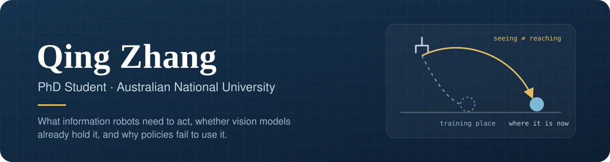

  

  
  

I study what information robots need to act, whether pretrained vision models already contain it, and why robot
policies often fail to use it. I am a PhD student in the School of Computing at the Australian National University,
advised by Jing Zhang and co-advised by Xuesong Li (CSIRO).

## Publications

**Seeing Is Not Reaching: Instruction Shortcuts Override Visual Grounding in Vision-Language-Action Models** 
**Qing Zhang**, Xuesong Li, Zhaoyuan Yang, Changlin Song, Xinyu Tian, Jing Zhang 
*arXiv preprint, 2026* · [Paper](https://arxiv.org/abs/2611.32206) · [Code](https://github.com/QZhang2111/psg) 
Vision-language-action models often reach for an object's training location after it has been moved.
Pathway-Separated Guidance (PSG) makes π0.5 reach the moved object, without training.

**Probing and Bridging Geometry–Interaction Cues for Affordance Reasoning in Vision Foundation Models** 
**Qing Zhang**, Xuesong Li, Jing Zhang 
*CVPR 2026* · [Project page](https://qingzhang.dev/projects/probing-bridging-affordance) · [Paper](https://openaccess.thecvf.com/content/CVPR2026/papers/Zhang_Probing_and_Bridging_Geometry-Interaction_Cues_for_Affordance_Reasoning_in_Vision_CVPR_2026_paper.pdf) · [Code](https://github.com/QZhang2111/Probing_Bridging_Affordance) 
We pair verb attention from an image editor with DINOv3's part features to predict where an action can take place.

**Improving Viewpoint Consistency in 3D Generation via Structure Feature and CLIP Guidance** 
**Qing Zhang**, Jinguang Tong, Jing Zhang, Jie Hong, Xuesong Li 
*ICCV 2025 Workshop* · [Paper](https://openaccess.thecvf.com/content/ICCV2025W/gDT-IV/html/Zhang_Improving_Viewpoint_Consistency_in_3D_Generation_via_Structure_Feature_and_ICCVW_2025_paper.html) · [arXiv](https://arxiv.org/abs/2412.02287) 
Uses structural guidance and CLIP to reduce inconsistent views in text-to-3D generation without additional training.

## Projects

**[Research-Pilot](https://github.com/QZhang2111/Research-Pilot)**: helps AI agents understand, maintain and advance
research projects through papers, claims, evidence, experiments and human-gated updates.
